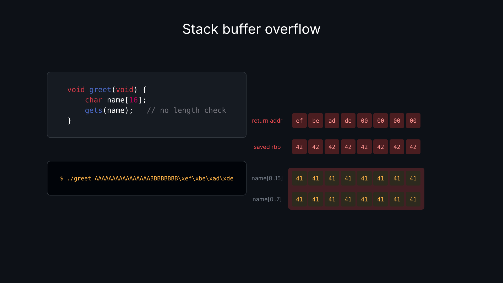
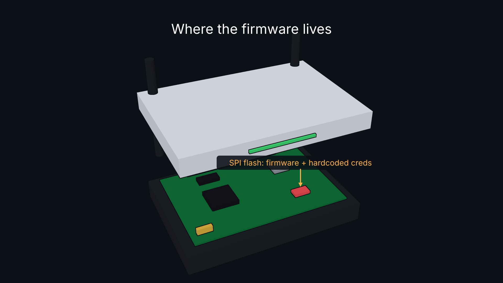

# Crowmation

A GPU-accelerated animation engine in Rust that turns short scripts in its own
scene language into 2D and 3D explainer videos.

Inspired by [Manim](https://www.manim.community/), built for speed: a 36 second
1080p60 video with text, code, animated bytes and a 3D model renders to MP4 in
about 2 seconds on an RTX 4090.




## Features

- **A small, safe scene language** (`.cwm`): objects, components, imports,
  lists, bounded loops, unit-checked math (`2s + 500ms`, `45deg`), and
  absolute or relative timing. No unbounded loops, no recursion, no file or
  network access, so every scene terminates and is checked before rendering.
- **Helpful errors.** The compiler reports as many errors as it can at once,
  each pointing at the source line.
- **Text, code and math** laid out by [Typst](https://typst.app/) and drawn as
  vector outlines, sharp at any size. Code is syntax highlighted. Inter is the
  default font.
- **2D vector graphics** by [vello](https://github.com/linebender/vello) on the
  GPU: shapes, arrows, images, outlines.
- **Optional 3D.** Load `.glb` models and animate their named parts. 2D and 3D
  share one space and one depth buffer, so 2D objects and 3D parts can pass
  through each other. Flat shading with outlines, a camera that orbits, tilts
  and zooms, labels pinned to 3D parts, and exploded views.
- **Fast export.** Frames are converted to video format on the GPU and encoded
  with NVENC (NVIDIA hardware encoding), falling back to openh264 on machines
  without it. Frames where nothing changes are not rendered again.
- **Live preview** with scrubbing and hot reload on save.
- **Built-in cybersecurity library** (`import "std:cybersec"`): bytes, memory
  rows and grids, HTTP request and response panels, a browser mockup.

## Quick start

Requirements: Rust (edition 2024) and a GPU with Vulkan support. NVENC export
needs an NVIDIA GPU and driver, but not the CUDA toolkit. Linux is the only
tested platform so far.

```sh
# Open a live preview window (reloads when you save the file)
cargo run --release -p crowmation -- preview examples/showcase.cwm

# Render to MP4
cargo run --release -p crowmation -- render examples/showcase.cwm showcase.mp4
```

## Commands

```
crowmation preview <scene.cwm>
crowmation render  <scene.cwm> <out.mp4> [--encoder auto|nvenc|openh264] [--quality high]
crowmation frame   <scene.cwm> <seconds> <out.png>
crowmation check   <scene.cwm> [--dump-ir]
crowmation lsp
```

- `preview`: Space plays or pauses, Left/Right step one frame, Home/End jump,
  click or drag to scrub, Esc quits.
- `render`: `--quality high` gives files about 10% smaller and takes about
  2.5x longer.
- `frame`: renders a single frame to PNG.
- `check`: compiles and reports errors without rendering. `--dump-ir` prints
  the compiled timeline as RON.

## Editor support

`crowmation lsp` is a language server: errors as you type (from the real
compiler, on unsaved changes), completion and hover docs. Install the binary
first so editors can find it:

```sh
cargo install --path cli
```

**Neovim (0.11+):** copy `editors/nvim/crowmation.lua` to
`~/.config/nvim/plugin/` and set the repo path at its top. It adds the `cwm`
filetype, syntax highlighting and the language server. `K` shows docs
(with the usual `vim.lsp.buf.hover` mapping) and completion pops up as you
type.

**VS Code:** build and install the extension (highlighting plus the language
server):

```sh
cd editors/vscode
npm install
python3 package_vsix.py
code --install-extension crowmation.vsix
```

## A taste of the language

```
scene "hello" {
  size (1920, 1080)
  background #0d1117

  text title "The *gets()* problem" size 64 at (960, 200)
  code src "
    char buf[8];
    gets(buf);   // no length check
  " lang "c" size 32 at (960, 450)
  rect box size (200, 80) corner 12 color #388bfd at (960, 750)

  at 0.5s fade_in title duration 600ms
  after fade_in src
  with fade_in box
  after move box by (300, 0) duration 1.5s ease in_out
  wait 1s
  after color title to #e5484d
}
```

### Objects

| Object | Main properties |
|---|---|
| `rect` | `size`, `corner`, `outline`, `outline_width` |
| `circle` | `radius`, `outline`, `outline_width` |
| `arrow`, `line` | `from`, `to`, `width`, `head` |
| `text`, `code`, `math` | content string, `size`; `code` also takes `lang` |
| `image` | `.png` or `.jpg` path, `size` or `width` |
| `model` | `.glb` path, `size` (pixels across) |
| `camera` | `fov`, `at` (the point it looks at) |

Every object takes `at`, `color`, `opacity`, `rotation` and `scale`. In 3D
scenes, 2D objects also take `z` (depth, positive toward the viewer),
`layer overlay` (fixed to the screen) and `pin <part>` (follow a 3D part).

### Actions

`move`, `rotate`, `scale`, `fade`, `fade_in`, `fade_out`, `color`, plus
`orbit`, `tilt` and `explode` for 3D. Actions take `to` or `by`, `duration`
(default `1s`) and `ease` (`linear`, `in`, `out`, `in_out`).

### Timing

- `at 2s move ...`: starts at an absolute time.
- `after move ...`: starts when the previous action ends. `after 0.5s` adds a
  gap, and `after -0.2s` overlaps it.
- `with move ...`: starts together with the previous action.
- `wait 1s`: pauses.

### Reuse

```
import "std:cybersec"
import "lib/memory.cwm"

component cell(label, fill) {
  rect box size (56, 56) corner 6 color fill
  code t content label size 22
}

scene {
  let bytes = ["41", "42", "43"]
  repeat 3 as i {
    cell c[i] label bytes[i] fill #21262d at (200 + i * 62, 300)
  }
  fade_in c[1]
  color c[2].box to #e5484d
}
```

Parts of a component instance are addressed as `name.part`. Model parts use
their glTF node names, like `router.flash_chip`.

## 3D

A scene becomes 3D as soon as it declares a `camera` or a `model`. Until the
camera moves, 2D content looks exactly as it does in a 2D scene: the default
camera maps the `z = 0` plane to the frame at one unit per pixel.

```
camera cam fov 30deg
model router "models/router.glb" size 760 at (960, 640)
text lbl "SPI flash" size 30 pin router.flash_chip at (0, -100)

tilt cam to 32deg duration 1.6s
with orbit cam to -25deg duration 1.6s
after move router.lid by (0, -300)
after color router.flash_chip to #e5484d
with fade_in lbl
after explode router by 0.4
```

Models must be self-contained `.glb` files inside the scene's folder.
`cargo run -p crowmation-mesh --example router` regenerates the example router
model.

## Examples

| File | Shows |
|---|---|
| `examples/showcase.cwm` | Title card, buffer overflow, 3D router teardown |
| `examples/buffer_overflow.cwm` | A step-by-step stack buffer overflow |
| `examples/router.cwm` | 3D model, camera moves, pinned labels, a 2D card passing through 3D parts |
| `examples/web.cwm` | SQL injection with a browser and request/response panels |
| `examples/text.cwm` | Text, code, hex dumps and math |
| `examples/overflow.cwm` | Imports and components |

## Project layout

| Folder | Crate | Role |
|---|---|---|
| `core` | `crowmation-core` | Compiled timeline: objects, tracks, evaluation at time t |
| `lang` | `crowmation-lang` | `.cwm` lexer, parser and compiler, built-in libraries |
| `text` | `crowmation-text` | Typst layout with bundled fonts and no file access |
| `mesh` | `crowmation-mesh` | `.glb` loading |
| `render` | `crowmation-render` | vello 2D, 3D pass, outlines, GPU conversion to video format |
| `encode` | `crowmation-encode` | NVENC and openh264 encoding, MP4 muxing |
| `preview` | `crowmation-preview` | Preview window |
| `cli` | `crowmation` | The `crowmation` binary and language server |
| `editors` | | Neovim and VS Code support |

Run the tests with `cargo test --workspace` (some tests need a GPU).

## Status

Working: the language, 2D, text, code and math, images, 3D models and camera,
MP4 export, preview with hot reload, editor support for Neovim and VS Code.

Planned:
- Section cutaways for 3D models
- Language reference docs
- macOS support

## Credits

Built on [vello](https://github.com/linebender/vello),
[wgpu](https://wgpu.rs/), [Typst](https://typst.app/),
[gltf](https://github.com/gltf-rs/gltf),
[openh264](https://github.com/ralfbiedert/openh264-rs) and
[cudarc](https://github.com/coreylowman/cudarc). The bundled
[Inter](https://rsms.me/inter/) font is licensed under the SIL Open Font
License (`text/fonts/Inter-LICENSE.txt`).
